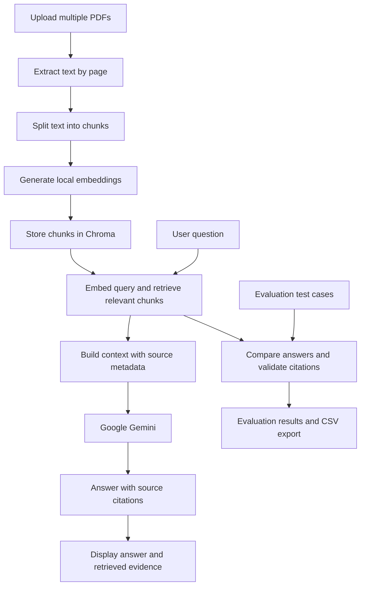

# SmartDocs RAG — Multi-PDF Question Answering

A Retrieval-Augmented Generation (RAG) application that lets users upload multiple PDF documents, ask natural-language questions, and receive answers grounded in retrieved document passages.

Built with Python, Streamlit, LangChain, Chroma, Hugging Face embeddings, and Google Gemini.

## Overview

SmartDocs RAG helps users find information across multiple documents without manually searching each PDF. It retrieves relevant text chunks and uses a language model to generate answers with source and page citations.

## Features

- **Multi-PDF ingestion:** Upload and process multiple PDF documents.
- **Semantic search:** Retrieve relevant passages using local sentence-transformer embeddings.
- **Context-grounded answers:** Generate responses using retrieved document context.
- **Source citations:** Display source filenames and page numbers in answers.
- **Evidence inspection:** Review retrieved passages to assess the basis of an answer.
- **Evaluation dashboard:** Test questions against expected answers and pages.
- **CSV export:** Export evaluation results for further analysis.

## Architecture



## Technology Stack

| Component | Technology |
|---|---|
| User interface | Streamlit |
| PDF extraction | pypdf |
| Text processing | LangChain text splitters |
| Embeddings | Hugging Face Sentence Transformers |
| Vector store | Chroma |
| Language model | Google Gemini |
| Evaluation and export | Pandas |

## How It Works

1. The user uploads one or more PDFs.
2. The application extracts text page by page and retains source and page metadata.
3. Extracted text is divided into overlapping chunks.
4. A sentence-transformer model creates vector embeddings for the chunks.
5. Chroma indexes the embedded chunks for similarity search.
6. When a question is submitted, the application retrieves relevant passages.
7. Gemini generates an answer using the retrieved context and is prompted to cite sources.
8. The evaluation dashboard tests questions, expected answers, and citation metadata.

## Run Locally

### Prerequisites

- Python installed
- A Google Gemini API key
- Git (optional for local execution)

### Installation

Clone the repository or download the project files, then open a terminal in the project folder.

Create a virtual environment:

```bash
python -m venv .venv
```

Activate it on Windows PowerShell:

```powershell
.\.venv\Scripts\Activate.ps1
```

Install the dependencies:

```bash
pip install -r requirements.txt
```

### Configure the API key

Create a file named `.streamlit/secrets.toml` and add:

```toml
GEMINI_API_KEY = "YOUR_GEMINI_API_KEY"
```

Replace the placeholder with your own API key. Do not commit this file or share the key publicly.

### Start the application

```bash
streamlit run app.py
```

Open the local URL shown in the terminal.

## Evaluation

The application includes an evaluation dashboard for testing retrieval-based answers against manually prepared test cases.

Record the results from actual test runs below.

| Evaluation measure | Result |
|---|---|
| Number of test cases | To be measured |
| Answer match rate | To be measured |
| Citation metadata validity rate | To be measured |
| Retrieval relevance | Requires manual review or a dedicated relevance metric |

**Interpretation and limitations**

- Exact normalized-text matching is a basic screening metric; correct answers can use different wording.
- Citation metadata validity indicates whether cited source/page pairs appear among the retrieved passages. It does not establish that a citation supports the associated claim.
- Retrieval relevance and factual correctness should be checked against the source PDFs.
- Report measured results only, including the number and type of test cases used.

## Current Limitations

- Answer quality depends on PDF text extraction, retrieval quality, and the language model.
- Scanned PDFs may require OCR before their contents can be searched.
- Citations require manual verification for factual support.
- The current vector index is built at runtime and may need to be rebuilt after the application restarts.
- Large PDFs and multiple uploads can increase processing time and memory usage.

## Future Improvements

- Persistent vector storage and document-level indexing
- OCR support for scanned documents
- More rigorous retrieval and answer-quality metrics
- Improved citation-to-claim verification
- Authentication, upload limits, and production monitoring

## Security

Keep API keys in Streamlit secrets or environment-based secret storage. Do not commit `.streamlit/secrets.toml`, private documents, or other confidential information to the repository.

## License

Add a license before distributing the project publicly. Until then, no reuse license is explicitly granted.